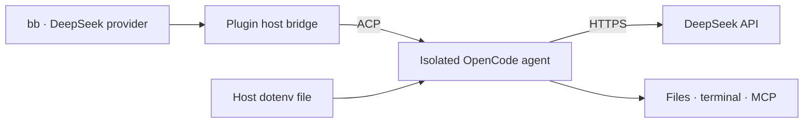

<div align="center">


# DeepSeek for bb

**Your DeepSeek API key. A dedicated coding agent in bb.**

[](https://github.com/torquemada163/bb-deepseek-plugin/actions/workflows/check.yml)
[](https://getbb.app)
[](https://opencode.ai)
[](LICENSE)

[Install](#install) · [Configuration](docs/configuration.md) · [Development](docs/development.md) · [Changelog](CHANGELOG.md)

</div>

Run **DeepSeek Flash** and **DeepSeek V4 Pro** as a separate provider in [bb](https://getbb.app). This plugin connects the DeepSeek API to OpenCode's coding tools through the Agent Client Protocol (ACP), with its own credentials and storage.

## What you get

- A **DeepSeek** provider with its own mark in bb's model picker.
- **Flash** for everyday work and **V4 Pro** for demanding tasks.
- **Off / Low / High / Max** reasoning controls, supplied through the ACP model catalog.
- File editing, terminal commands, and streamed responses through OpenCode.
- Multi-turn conversations and restored sessions through ACP.
- Host-local API credentials and separate OpenCode config, data, cache, and state.

## Install

**OpenCode is required separately.** Install [OpenCode](https://opencode.ai/docs/) **1.19.5 or newer** on every machine that runs your agents, then check `opencode --version`. Installing this bb plugin does not install OpenCode. If you access bb through a remote browser, install OpenCode on the execution host; the browser device does not need it.

Add this repository in bb's plugin installer, or run:

```sh
bb plugin install https://github.com/torquemada163/bb-deepseek-plugin
```

BB installs runtime dependencies and builds the plugin. A normal installation needs no manual clone or npm build.

**Requirements:** bb **0.48.1+** with Plugin SDK **0.6.104+**, OpenCode **1.19.5+**, and a [DeepSeek Platform](https://platform.deepseek.com/) API key with sufficient balance. API usage is billed by DeepSeek; a web chat account does not provide free API usage. Development checks target Node 22, macOS, and Linux.

## Connect your account

Create a private dotenv file on the **execution host** using your editor:

```dotenv
DEEPSEEK_API_KEY=your-deepseek-api-key
```

For example, use `~/.config/bb-deepseek/credentials.env`. On macOS/Linux, create the directory first and protect the file with `chmod 600`.

In **Settings → Plugins → DeepSeek**, set **API key dotenv file** to its absolute path. Set **OpenCode executable** to an absolute path if the CLI is absent from the host's PATH.

The equivalent CLI configuration is:

```sh
bb plugin config deepseek set envFile "$HOME/.config/bb-deepseek/credentials.env"
# Optional, when PATH discovery is unavailable:
bb plugin config deepseek set executable /absolute/path/to/opencode
bb provider models deepseek --json
```

Start a thread, select **DeepSeek**, choose a model and reasoning level, and send a task.

## Models

| Model | BB model ID | Reasoning |
| --- | --- | --- |
| DeepSeek Flash | `deepseek/deepseek-flash` | Off / Low / High / Max |
| DeepSeek V4 Pro | `deepseek/deepseek-v4-pro` | Off / Low / High / Max |

Flash is the default. To change the default for new threads:

```sh
bb plugin config deepseek set model deepseek-v4-pro
```

The catalog uses the current API IDs documented by [DeepSeek](https://api-docs.deepseek.com/). Model availability and billing depend on your API account. **Off** disables thinking; **Default** uses High. Inherited bb settings are accepted before thread creation and mapped as documented by DeepSeek:

| Requested level | DeepSeek behavior |
| --- | --- |
| None / Off | Thinking disabled |
| Minimal / Low | Low |
| Medium / High / Extra High | High |
| Max / Ultra | Max |

Minimal is an API alias; bb's provider-level picker does not define that level.

## How it works



**DeepSeek is the model; OpenCode is the agent runtime.** DeepSeek generates responses through its API. OpenCode supplies the agent loop, system instructions, file and terminal tools, and session handling. bb presents the conversation and manages the provider connection. Because OpenCode supplies the system instructions, the assistant may introduce itself as OpenCode while correctly reporting a DeepSeek model ID. This does not mean a different model is answering.

A separate OpenCode subscription or provider login is not required for this connection: the plugin uses your DeepSeek API key, and DeepSeek bills the model requests. An independently installed OpenCode CLI is still required.

The bb server stores a path to your credentials file. The bridge reads the key on the execution host and passes it to the agent process. Generated configuration uses an environment reference; the plugin does not write the API key into its configuration files.

Claude Code, Codex, Kimi, and your standalone OpenCode configuration keep their existing settings.

## Scope and limitations

- Native bb forks, manual compaction, quota reporting, and archive/rename forwarding are not exposed.
- Permissions use bb's ACP adapter. `accept-edits` and `full` are agent permission modes, not an operating system sandbox.
- Project OpenCode configuration and automatic third-party OpenCode plugins are disabled for this provider. Project `AGENTS.md` rules and bb-supplied context still apply.
- Host paths are shared plugin settings. Every execution host must have the configured CLI and credentials path.
- The API key is available to the agent process and its tools. Protect the host and run trusted workspaces.

[Configuration and troubleshooting →](docs/configuration.md)

## Development

```sh
npm ci --ignore-scripts
npm run typecheck
npm test
npm run build
npm run check:install
npm run check:package
```

Live smoke checks are opt-in, use a local `.env`, and incur API usage. See [the development guide](docs/development.md).

## License

[MIT](LICENSE). DeepSeek branding is provided by [Lobe Icons](https://github.com/lobehub/lobe-icons) under MIT; see [asset attribution](assets/README.md). This is an independent community integration.
